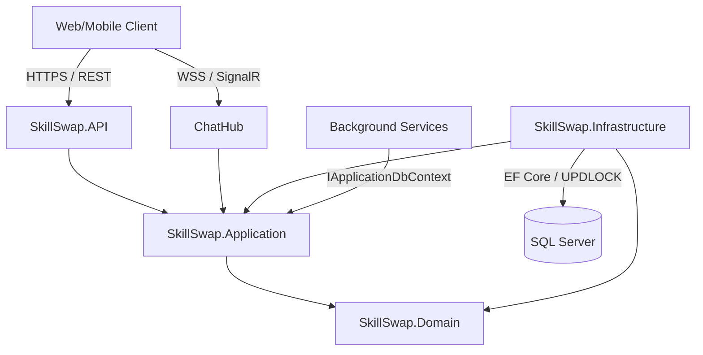
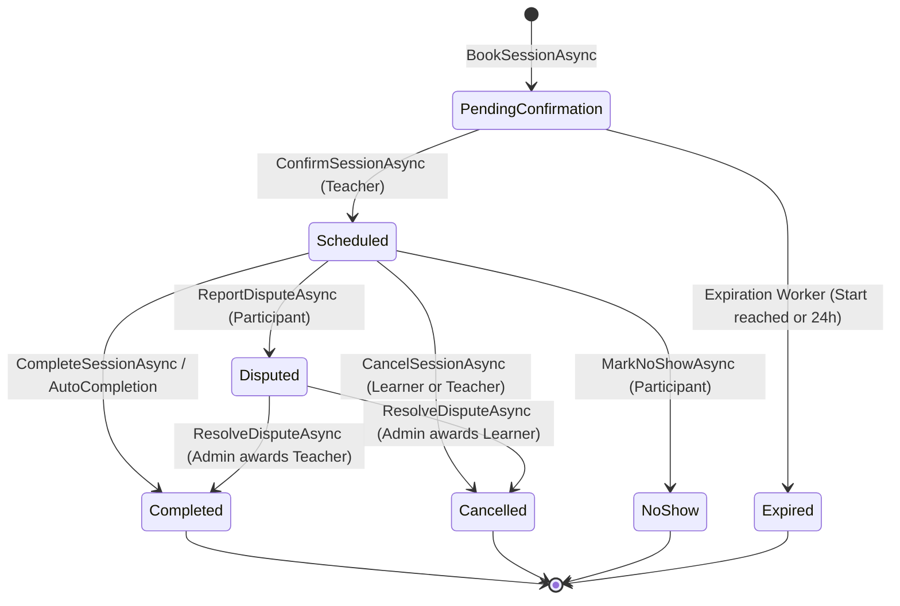
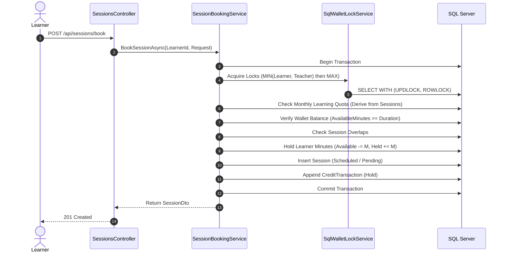

# SkillSwap Backend — Team Architecture Specification

This document serves as the master architectural blueprint and technical contract for the SkillSwap backend. All four developers must design and implement code according to the boundaries, matrices, and invariants defined herein.

---

## Table of Contents
1. [System Overview](#1-system-overview)
2. [Architecture Layers & Dependency Rules](#2-architecture-layers--dependency-rules)
3. [Project Dependency Map](#3-project-dependency-map)
4. [Domain Ownership Matrix (22 Entities)](#4-domain-ownership-matrix-22-entities)
5. [Module Ownership Breakdown](#5-module-ownership-breakdown)
6. [Ownership vs Execution Phases](#6-ownership-vs-execution-phases)
7. [Shared Infrastructure Ownership](#7-shared-infrastructure-ownership)
8. [Database Ownership & Migration Rules](#8-database-ownership--migration-rules)
9. [Cross-Module Business Contracts](#9-cross-module-business-contracts)
10. [API Ownership Matrix](#10-api-ownership-matrix)
11. [Shared File Rules](#11-shared-file-rules)
12. [Authentication & Authorization Boundaries](#12-authentication--authorization-boundaries)
13. [Financial & Transactional Boundary](#13-financial--transactional-boundary)
14. [SignalR & Real-Time Boundary](#14-signalr--real-time-boundary)
15. [Subscription & Quota Boundary](#15-subscription--quota-boundary)
16. [Testing Boundaries & Quality Gates](#16-testing-boundaries--quality-gates)
17. [Official Project Execution Roadmap (Phases 1-9)](#17-official-project-execution-roadmap-phases-1-9)
18. [Contract Change-Management Rules](#18-contract-change-management-rules)
19. [Known Deferred Items (Non-MVP Scope)](#19-known-deferred-items-non-mvp-scope)
20. [Terminology Disambiguation Guide](#20-terminology-disambiguation-guide)
21. [Architectural & Lifecycle Diagrams](#21-architectural--lifecycle-diagrams)

---

## 1. System Overview

SkillSwap is a peer-to-peer time-banking platform where users exchange skills without fiat money. The fundamental currency of the platform is **time minutes**:
- **1 conceptual credit = 30 minutes**.
- All ledger and balance values are stored strictly as **integer minutes**.
- When a user learns a skill, their time minutes are held in escrow and transferred to the teacher upon verified session completion.
- When a user teaches a skill, they earn time minutes that can later be spent learning other skills.

The backend is organized as a modular Clean Architecture solution using .NET 10, C# 13, Entity Framework Core, SQL Server, and ASP.NET Core Web API with SignalR.

---

## 2. Architecture Layers & Dependency Rules

The solution strictly enforces Clean Architecture dependency boundaries with precise technical definitions:

```
+--------------------------------------------------------+
|                   SkillSwap.API                        |
|   (Controllers, Hubs, Middlewares, Program.cs)         |
+--------------------------+-----------------------------+
                           | references
                           v
+--------------------------------------------------------+
|              SkillSwap.Infrastructure                  |
|   (EF Core, SqlServer, Identity, Background Jobs, DI)  |
+--------------------------+-----------------------------+
                           | references
                           v
+--------------------------------------------------------+
|              SkillSwap.Application                     |
|   (Use Cases, DTOs, Service Interfaces, Results)       |
+--------------------------+-----------------------------+
                           | references
                           v
+--------------------------------------------------------+
|                 SkillSwap.Domain                       |
|   (Entities, Enums, Exceptions, Domain Rules)          |
+--------------------------------------------------------+
```

### Dependency Rules:
1. `SkillSwap.Domain`: Pure C# business domain. Has **zero** project dependencies and zero framework dependencies.
2. `SkillSwap.Application`: Depends **only** on `SkillSwap.Domain`. Owns all service contracts/abstractions (`IApplicationDbContext`, `IWalletService`, `ISessionService`, `IChatService`, etc.). Must **never** reference `Infrastructure` or `API`.
3. `SkillSwap.Infrastructure`: Implements abstractions defined in `Application` and `Domain`. References `Domain` and `Application`.
4. `SkillSwap.API`: Presentation layer. References `Application` and `Infrastructure` (solely for dependency injection wiring in `Program.cs`). Controllers interact strictly through Application interfaces.
5. `SkillSwap.Tests`: Unit and integration test suites referencing all projects.

---

## 3. Project Dependency Map

```
SkillSwap.sln
├── src/SkillSwap.Domain/
├── src/SkillSwap.Application/       --> depends on Domain
├── src/SkillSwap.Infrastructure/    --> depends on Application, Domain
├── src/SkillSwap.API/               --> depends on Infrastructure, Application, Domain
└── tests/SkillSwap.Tests/           --> references API, Infrastructure, Application, Domain
```

---

## 4. Domain Ownership Matrix (22 Entities)

The domain model contains **22 entities**, 12 enums, and 7 specialized domain exceptions. Ownership is partitioned across the **four developers**:

### Entity Ownership Table

| # | Entity | Primary Key Type | Owning Module | Lead Developer | Primary Table Name |
|---|---|---|---|---|---|
| 1 | `Session` | `long` | Session & Wallet | Developer 1 | `Sessions` |
| 2 | `Wallet` | `Guid` | Session & Wallet | Developer 1 | `Wallets` |
| 3 | `CreditTransaction` | `long` | Session & Wallet | Developer 1 | `CreditTransactions` |
| 4 | `SwapRequest` | `long` | Swap Lifecycle & Sessions | Developer 1 | `SwapRequests` |
| 5 | `Conversation` | `long` | Swap Lifecycle & Messaging | Developer 1 | `Conversations` |
| 6 | `ConversationParticipant` | `(long, Guid)` | Swap Lifecycle & Messaging | Developer 1 | `ConversationParticipants` |
| 7 | `Message` | `long` | Swap Lifecycle & Messaging | Developer 1 | `Messages` |
| 8 | `Review` | `long` | Platform Features | Developer 2 | `Reviews` |
| 9 | `SubscriptionPlan` | `int` | Platform Features | Developer 2 | `SubscriptionPlans` |
| 10 | `UserSubscription` | `long` | Platform Features | Developer 2 | `UserSubscriptions` |
| 11 | `Notification` | `long` | Platform Features | Developer 2 | `Notifications` |
| 12 | `Badge` | `int` | Platform Features | Developer 2 | `Badges` |
| 13 | `UserBadge` | `(Guid, int)` | Platform Features | Developer 2 | `UserBadges` |
| 14 | `Favorite` | `(Guid, Guid)` | Platform Features | Developer 2 | `Favorites` |
| 15 | `UserBlock` | `(Guid, Guid)` | Platform Features | Developer 2 | `UserBlocks` |
| 16 | `Report` | `long` | Platform Features | Developer 2 | `Reports` |
| 17 | `Category` | `int` | Skills & Matching | Developer 3 | `Categories` |
| 18 | `Skill` | `int` | Skills & Matching | Developer 3 | `Skills` |
| 19 | `UserSkill` | `long` | Skills & Matching | Developer 3 | `UserSkills` |
| 20 | `AvailabilitySlot` | `long` | Skills & Matching | Developer 3 | `AvailabilitySlots` |
| 21 | `ApplicationUser` | `Guid` | Auth & Profile | Developer 4 | `Users` |
| 22 | `UserProfile` | `Guid` | Auth & Profile | Developer 4 | `UserProfiles` |

### Enum Ownership Table

| Enum | Underlying Type | Values / Meanings | Owning Developer |
|---|---|---|---|
| `CreditTransactionType` | `byte` | Bonus(1), Hold(2), Release(3), Capture(4), Earn(5), Adjustment(6) | Developer 1 |
| `NoShowParty` | `byte` | Learner(1), Teacher(2), Both(3) | Developer 1 |
| `SessionMode` | `byte` | Online(1), InPerson(2) | Developer 1 |
| `SessionStatus` | `byte` | PendingConfirmation(1), Scheduled(2), Completed(3), Cancelled(4), NoShow(5), Disputed(6), Expired(7) | Developer 1 |
| `SwapRequestStatus` | `byte` | Pending(1), Accepted(2), Declined(3), Cancelled(4), Expired(5) | Developer 1 |
| `NotificationKind` | `byte` | SwapRequest(1), SessionReminder(2), SessionCompleted(3), SessionCancelled(4), NewMessage(5), ReviewReceived(6), BadgeEarned(7), System(8) | Developer 2 |
| `ReportReason` | `byte` | Harassment(1), InappropriateContent(2), Spam(3), NoShow(4), Fraud(5), Other(6) | Developer 2 |
| `ReportStatus` | `byte` | Open(1), UnderReview(2), Resolved(3), Rejected(4) | Developer 2 |
| `SubscriptionPlanType` | `int` | Free(1), Premium(2) | Developer 2 |
| `SubscriptionStatus` | `byte` | Active(1), Cancelled(2), Expired(3) | Developer 2 |
| `UserSkillLevel` | `byte` | Beginner(1), Intermediate(2), Advanced(3) | Developer 3 |
| `UserSkillType` | `byte` | Teach(1), Learn(2) [Aliases: Teaching=1, Learning=2] | Developer 3 |

### Domain Exceptions Matrix

All domain exceptions inherit from `DomainException` (`src/SkillSwap.Domain/Exceptions/DomainException.cs`):
- `InsufficientBalanceException`: Thrown when available minutes are insufficient for hold. (Owner: Developer 1)
- `InvalidSessionStateException`: Thrown on illegal session state transitions. (Owner: Developer 1)
- `NotFoundException`: Generic entity not found exception. (Shared)
- `QuotaExceededException`: Thrown when monthly learning minutes exceed plan cap. (Owner: Developer 1)
- `SessionOverlapException`: Thrown when a participant has a time collision. (Owner: Developer 1)
- `UnauthorizedSessionAccessException`: Thrown when an unauthenticated or unrelated user attempts session operations. (Owner: Developer 1)

---

## 5. Module Ownership Breakdown

### Module 1: Sessions, Wallet, Swap Lifecycle, Real-Time Chat & Hosting (Developer 1 — Islam Khaled)
- **Scope:** Core financial engine, wallet balances, escrow hold/capture/release, session booking and lifecycle execution, concurrency control, monthly learning quota enforcement, no-show arbitration, dispute backend, background workers, SwapRequest negotiation lifecycle, SignalR `ChatHub` (`/hubs/chat`), **sole ownership of EF Core migrations**, and **Developer 1 — Production Deployment & Hosting** on MonsterASP.NET.
- **Invariants:**
  - Wallet balances (`AvailableMinutes`, `HeldMinutes`) can never be negative.
  - Escrow bookings, completions, cancellations, and no-shows must update Wallet and CreditTransaction in the same transaction.
  - Quota is evaluated strictly after deterministic row locks (`UPDLOCK, ROWLOCK`) on wallets ordered by `UserId`.
  - Double completion is prevented by conditional SQL execution: `UPDATE Sessions SET Status = Completed WHERE Status = Scheduled`.
  - `SwapRequest.RequesterId = Learner`, `SwapRequest.ReceiverId = Teacher`. Roles are never inverted.
  - `SwapRequest` never has a `Completed` status.
  - SignalR group authorization checks participant membership before allowing connection to `conversation_{id}`.
- **Prohibited:** Must not implement public profile or category CRUD APIs.

### Module 2: Platform Features & Conversations REST API (Developer 2 — Arwa Khalid)
- **Scope:** Session reviews and dynamic ratings, notifications (`Notification`), gamification badges (`Badge`, `UserBadge`), user favorites (`Favorite`), user blocking (`UserBlock`), moderation reporting (`Report`), subscription capability tiers (`SubscriptionPlan`, `UserSubscription`), and the **ConversationsController REST API** (`GET /api/conversations`, `GET /api/conversations/{id}`, `GET /api/conversations/{id}/messages`, `POST /api/conversations/{id}/messages`, `POST /api/conversations/{id}/read`).
- **Invariants:**
  - Reviews can only be submitted for sessions with `Status = Completed` by actual participants.
  - Blocked users cannot send swap requests or message each other.
  - REST messaging dispatches through `IChatService` and triggers SignalR group broadcast.
  - **Monetization Invariant:** Subscription pricing is unresolved in MVP. `SubscriptionPlan.Price` is `NULL` for Premium, `0.00` for Free. No real payment gateway integration in MVP.
- **Prohibited:** Must not modify core session booking, wallet balances, or credit ledgers.

### Module 3: Skills, Availability & Matching (Developer 3 — Mario Wael)
- **Scope:** Category taxonomy, master skill definitions, user skill associations (`UserSkill` with `Type = Teach` or `Type = Learn`), recurring weekly availability slots (`AvailabilitySlot`), skill search, and computed matching algorithm.
- **Invariants:**
  - `Skill.Name` must be unique per `CategoryId`.
  - A user cannot teach and learn the same skill with duplicate rows.
  - **Matching is strictly computed dynamically**. There is **no persisted Match entity**. Recommendations are generated via query algorithms.
- **Prohibited:** Must not manage SwapRequest lifecycles, real-time messaging, or session scheduling.

### Module 4: Auth & Profile (Developer 4 — Kholoud Khaled)
- **Scope:** User registration, password security, login, JWT token issuance, ASP.NET Core Identity integration, user roles, profile management, startup key validation, and current user context.
- **Invariants:**
  - Passwords must comply with enterprise identity rules (min 8 chars, digit, uppercase, lowercase, special char).
  - Each registered user must have an active `UserProfile` created.
  - New user registration must initialize a default `Wallet` (via Developer 1 contract) and a default `UserSubscription` with the Free plan (via Developer 2 contract).
- **Prohibited:** Must not modify financial engines, wallet ledgers, swap negotiations, or session booking.

---

## 6. Ownership vs Execution Phases

A critical distinction in this project is the difference between **Ownership** and **Execution Phases**:

```
+-------------------------------------------------------------+
|                        OWNERSHIP                            |
|             "Who owns this code / module?"                  |
|  - Assigned to a specific Developer (Developer 1 to 4).     |
|  - Defines code review rights, PR merge approvals, and      |
|    functional accountability.                               |
+-------------------------------------------------------------+

+-------------------------------------------------------------+
|                     EXECUTION PHASES                        |
|             "In what sequence is work completed?"           |
|  - Sequential milestones (Phase 1 to Phase 9).              |
|  - A developer's ownership spans multiple phases.           |
+-------------------------------------------------------------+
```

---

## 7. Shared Infrastructure Ownership

| Component | Primary Maintainer | Reviewers | Purpose |
|---|---|---|---|
| `IApplicationDbContext` | Developer 1 | All Developers | Database abstraction in Application layer |
| `ApplicationDbContext` | Developer 1 | All Developers | EF Core context implementation |
| `ICurrentUserService` | Developer 4 | Developer 1 | Resolves current authenticated user claims |
| `IDateTimeProvider` | Developer 1 | All Developers | Deterministic UTC clock abstraction |
| `GlobalExceptionHandlingMiddleware` | Developer 1 / Team | All Developers | Centralized HTTP exception translation |
| `SqlWalletLockService` | Developer 1 | Developer 1 | Raw SQL row-level concurrency lock provider |

---

## 8. Database Ownership & Migration Rules

> **CRITICAL DIRECTIVE:**
> **Developer 1 is the exclusive authority for Entity Framework Core migrations.**
> Independent execution of `dotnet ef migrations add` by other developers is strictly prohibited.

### Schema Update Workflow:
1. Developers define new or modified entities under `src/SkillSwap.Domain/Entities/`.
2. Developers create or modify configuration classes in `src/SkillSwap.Infrastructure/Persistence/Configurations/`.
3. Developers submit configuration changes to Developer 1.
4. Developer 1 reviews foreign keys (ensuring `DeleteBehavior.Restrict`), adds indexes, executes `dotnet ef migrations add`, and verifies the snapshot.

---

## 9. Cross-Module Business Contracts

1. **User Identity Invariant (Developer 4):**
   - User primary key is strictly `Guid`.
   - All modules anchor user records to this `Guid`.
2. **Registration Bootstrapping Contract (Developers 4, 1, 2):**
   - When a user successfully registers:
     1. Insert `ApplicationUser` (Developer 4).
     2. Insert `UserProfile` (Developer 4).
     3. Insert `Wallet` with 0 balance (Developer 1 contract).
     4. Insert `UserSubscription` on Free plan (Developer 2 contract).
   - All 4 records are saved atomically.
3. **Skill Verification for Swap Requests (Developers 3 & 1):**
   - When a swap request is created, `SwapRequestService` verifies that `ReceiverId` actively offers `SkillId` with `Type = Teach` via Developer 3's `UserSkills`.
4. **Safety Blocks Contract (Developers 1 & 2):**
   - A swap request cannot be proposed if either participant has an active block in Developer 2's `UserBlocks`.
5. **Review Eligibility Contract (Developers 1 & 2):**
   - Reviews can only be submitted for sessions that have reached `SessionStatus.Completed`.
6. **Monthly Learning Quota Contract (Developers 1 & 2):**
   - `QuotaService` checks Developer 2's `UserSubscription` to determine whether the user is capped at 180 minutes (Free) or 720 minutes (Premium).
7. **SignalR / REST Chat Coordination (Developers 1 & 2):**
   - REST message sending in `ConversationsController` (Developer 2) persists via `IChatService` and broadcasts to `ChatHub` (Developer 1) connected clients via `IHubContext<ChatHub>`.

---

## 10. API Ownership Matrix

| Controller / Endpoint Area | Method | Route | Description | Owning Developer | Auth | Role | Status |
|---|---|---|---|---|---|---|---|
| **Auth** | POST | `/api/auth/register` | Register new user account | Developer 1 | No | Anonymous | **IMPLEMENTED** |
| **Auth** | POST | `/api/auth/login` | Authenticate with credentials | Developer 1 | No | Anonymous | **IMPLEMENTED** |
| **Profiles** | GET | `/api/profiles/me` | Current user profile | Developer 1 | Yes | Authenticated | **IMPLEMENTED** |
| **Profiles** | PUT | `/api/profiles/me` | Update current user profile | Developer 1 | Yes | Authenticated | **IMPLEMENTED** |
| **Profiles** | GET | `/api/profiles/{id}` | Get public profile by user ID | Developer 1 | Yes | Authenticated | **IMPLEMENTED** |
| **Categories** | GET | `/api/categories` | List active categories | Developer 2 | No | Anonymous | **IMPLEMENTED** |
| **Categories** | POST | `/api/categories` | Create new category | Developer 2 | Yes | Admin | **IMPLEMENTED** |
| **Skills** | GET | `/api/skills` | Search skills catalog | Developer 2 | No | Anonymous | **IMPLEMENTED** |
| **Skills** | GET | `/api/skills/{id}` | Get skill details | Developer 2 | No | Anonymous | **IMPLEMENTED** |
| **Skills** | POST | `/api/skills` | Create new skill | Developer 2 | Yes | Admin | **IMPLEMENTED** |
| **User Skills** | GET | `/api/user-skills/me` | List caller's skills | Developer 2 | Yes | Authenticated | **IMPLEMENTED** |
| **User Skills** | POST | `/api/user-skills` | Declare teach/learn skill | Developer 2 | Yes | Authenticated | **IMPLEMENTED** |
| **User Skills** | DELETE | `/api/user-skills/{id}` | Remove declared skill | Developer 2 | Yes | Authenticated | **IMPLEMENTED** |
| **Availability** | GET | `/api/availability/me` | Get caller's availability | Developer 2 | Yes | Authenticated | **IMPLEMENTED** |
| **Availability** | PUT | `/api/availability/me` | Update caller's availability | Developer 2 | Yes | Authenticated | **IMPLEMENTED** |
| **Matching** | GET | `/api/matches` | Get computed matches | Developer 2 | Yes | Authenticated | **IMPLEMENTED** |
| **Swap Requests** | POST | `/api/swap-requests` | Create new swap proposal | Developer 3 | Yes | Authenticated | **IMPLEMENTED** |
| **Swap Requests** | GET | `/api/swap-requests/incoming` | List incoming proposals | Developer 3 | Yes | Authenticated | **IMPLEMENTED** |
| **Swap Requests** | GET | `/api/swap-requests/outgoing` | List outgoing proposals | Developer 3 | Yes | Authenticated | **IMPLEMENTED** |
| **Swap Requests** | GET | `/api/swap-requests/{id}` | Get proposal details | Developer 3 | Yes | Authenticated | **IMPLEMENTED** |
| **Swap Requests** | POST | `/api/swap-requests/{id}/accept` | Accept swap proposal | Developer 3 | Yes | Authenticated | **IMPLEMENTED** |
| **Swap Requests** | POST | `/api/swap-requests/{id}/decline` | Decline swap proposal | Developer 3 | Yes | Authenticated | **IMPLEMENTED** |
| **Swap Requests** | POST | `/api/swap-requests/{id}/cancel` | Cancel outgoing proposal | Developer 3 | Yes | Authenticated | **IMPLEMENTED** |
| **Conversations** | GET | `/api/conversations` | List user's conversations | Developer 4 | Yes | Authenticated | **IMPLEMENTED** |
| **Conversations** | GET | `/api/conversations/{id}` | Get conversation metadata | Developer 4 | Yes | Authenticated | **IMPLEMENTED** |
| **Conversations** | GET | `/api/conversations/{id}/messages` | Get paginated message history | Developer 4 | Yes | Authenticated | **IMPLEMENTED** |
| **Conversations** | POST | `/api/conversations/{id}/messages` | Send message via REST API | Developer 4 | Yes | Authenticated | **IMPLEMENTED** |
| **Conversations** | POST | `/api/conversations/{id}/read` | Mark conversation as read | Developer 4 | Yes | Authenticated | **IMPLEMENTED** |
| **SignalR Chat** | WS | `/hubs/chat` | Real-time messaging hub | Developer 3 | Yes | Authenticated | **IMPLEMENTED** |
| **Sessions** | POST | `/api/sessions` | Book session with escrow hold | Developer 3 | Yes | Authenticated | **IMPLEMENTED** |
| **Sessions** | GET | `/api/sessions/{id}` | Get session details | Developer 3 | Yes | Authenticated | **IMPLEMENTED** |
| **Sessions** | POST | `/api/sessions/{id}/confirm` | Teacher confirms session | Developer 3 | Yes | Authenticated | **IMPLEMENTED** |
| **Sessions** | POST | `/api/sessions/{id}/join` | Participant joins session | Developer 3 | Yes | Authenticated | **IMPLEMENTED** |
| **Sessions** | POST | `/api/sessions/{id}/complete` | Complete session & payout | Developer 3 | Yes | Authenticated | **IMPLEMENTED** |
| **Sessions** | POST | `/api/sessions/{id}/cancel` | Cancel session & refund | Developer 3 | Yes | Authenticated | **IMPLEMENTED** |
| **Sessions** | POST | `/api/sessions/{id}/no-show` | Report participant no-show | Developer 3 | Yes | Authenticated | **IMPLEMENTED** |
| **Sessions** | POST | `/api/sessions/{id}/dispute` | Escalate session dispute | Developer 3 | Yes | Authenticated | **IMPLEMENTED** |
| **Admin Wallets**| POST | `/api/admin/wallets/{userId}/bonus` | Admin idempotent bonus grant | Developer 3 | Yes | Admin | **IMPLEMENTED** |
| **Reviews** | POST | `/api/reviews` | Submit post-session review | Developer 4 | Yes | Authenticated | **IMPLEMENTED** |
| **Reviews** | GET | `/api/reviews/user/{userId}` | Get reviews for a user | Developer 4 | No | Anonymous | **IMPLEMENTED** |
| **Notifications** | GET | `/api/notifications` | List user notifications | Developer 4 | Yes | Authenticated | **IMPLEMENTED** |
| **Notifications** | POST | `/api/notifications/{id}/read` | Mark notification as read | Developer 4 | Yes | Authenticated | **IMPLEMENTED** |
| **Badges** | GET | `/api/badges` | List all platform badges | Developer 4 | No | Anonymous | **IMPLEMENTED** |
| **Badges** | GET | `/api/badges/user/{userId}` | List badges awarded to user | Developer 4 | Yes | Authenticated | **IMPLEMENTED** |
| **Favorites** | GET | `/api/favorites` | List favorite users | Developer 4 | Yes | Authenticated | **IMPLEMENTED** |
| **Favorites** | POST | `/api/favorites/{userId}` | Add user to favorites | Developer 4 | Yes | Authenticated | **IMPLEMENTED** |
| **Favorites** | DELETE | `/api/favorites/{userId}` | Remove user from favorites | Developer 4 | Yes | Authenticated | **IMPLEMENTED** |
| **Blocks** | POST | `/api/blocks/{userId}` | Block another user | Developer 4 | Yes | Authenticated | **IMPLEMENTED** |
| **Blocks** | DELETE | `/api/blocks/{userId}` | Unblock a user | Developer 4 | Yes | Authenticated | **IMPLEMENTED** |
| **Reports** | POST | `/api/reports` | Submit moderation report | Developer 4 | Yes | Authenticated | **IMPLEMENTED** |
| **Subscriptions** | GET | `/api/subscriptions/plans` | List available subscription plans | Developer 4 | No | Anonymous | **IMPLEMENTED** |
| **Subscriptions** | GET | `/api/subscriptions/me` | Get current user's active plan | Developer 4 | Yes | Authenticated | **IMPLEMENTED** |
| **Subscriptions** | POST | `/api/subscriptions/subscribe` | Mock subscribe to plan | Developer 4 | Yes | Authenticated | **IMPLEMENTED** |

---

## 11. Shared File Rules

| File / Component Path | Primary Owner | Who May Edit | Consultation Required | Actions Requiring Team Review |
|---|---|---|---|---|
| `src/.../Persistence/ApplicationDbContext.cs` | Developer 3 | Developer 3 | Developer 3 | Adding DbSets, changing model conventions, table mappings |
| `src/.../Identity/ApplicationUser.cs` | Developer 1 | Developer 1 | Developer 3 | Adding identity properties, changing primary keys |
| `src/.../Services/CurrentUserService.cs` | Developer 1 | Developer 1 | All Developers | Modifying claims extraction or role checking |
| `src/.../Services/JwtTokenService.cs` | Developer 1 | Developer 1 | Developer 1 | Altering JWT claim format or expiry |
| `src/.../Services/DateTimeProvider.cs` | Developer 3 | Developer 3 | All Developers | Altering time abstraction interface `IDateTimeProvider` |
| `src/.../Services/SqlWalletLockService.cs` | Developer 3 | Developer 3 | Lead | Altering SQL Server lock hints or ordering |
| `src/SkillSwap.API/Program.cs` | Developer 3 | All (scoped) | Developer 3 | Changing middleware pipeline, CORS, or DI calls |
| `src/SkillSwap.API/Hubs/ChatHub.cs` | Developer 3 | Developer 3 | Developer 3 | Modifying hub methods or connection auth |
| `src/SkillSwap.API/Controllers/ConversationsController.cs` | Developer 4 | Developer 4 | Developer 3 | Modifying REST messaging routes or DTOs |
| `src/SkillSwap.API/Extensions/AuthenticationExtensions.cs` | Developer 1 | Developer 1 | Developer 1 | Changing JWT validation parameters |
| `src/SkillSwap.API/Extensions/SwaggerExtensions.cs` | Shared | Shared | Lead | Changing security definitions or API metadata |
| `src/SkillSwap.API/Middleware/GlobalExceptionHandlingMiddleware.cs` | Developer 3 | Developer 3 | All Developers | Modifying exception to HTTP status code mappings |

---

## 12. Authentication & Authorization Boundaries

- **JWT Bearer Token:** The API uses standard JWT Bearer authentication. Claims include `sub` (User GUID), `email`, and `roles`.
- **User Identity Context:** Application code retrieves caller identity via `ICurrentUserService.UserId`.
- **Role Enforcement:**
  - Standard user endpoints are protected by `[Authorize]`.
  - Administrative endpoints (such as `POST /api/admin/wallets/{userId}/bonus`) are strictly guarded by `[Authorize(Roles = "Admin")]`.
- **Defense in Depth:** Even with valid admin tokens, business services enforce domain invariants.

---

## 13. Financial & Transactional Boundary

- **Atomicity:** All mutations touching `Wallet.AvailableMinutes`, `Wallet.HeldMinutes`, or `CreditTransactions` must execute inside a database transaction (`IDbContextTransaction`).
- **Ledger Invariant:** Every modification to a wallet's balances must be accompanied by an append-only `CreditTransaction` record documenting the `AvailableDelta`, `HeldDelta`, and `CreditTransactionType`.
- **Idempotency Protection:** Administrative bonus grants and adjustments enforce idempotency keys backed by the unique filtered index `UX_CreditTransaction_IdempotencyKey`.
- **Double Completion Guard:** Double execution is blocked by conditional atomic updates:
  ```sql
  UPDATE Sessions SET Status = 3, UpdatedAtUtc = @Now WHERE Id = @Id AND Status = 2
  ```

---

## 14. SignalR & Real-Time Boundary

- **Endpoint:** `/hubs/chat` mapped in `Program.cs`.
- **Authorization:** Requires authenticated JWT token (configured to extract token from `access_token` query parameter during WebSocket handshake).
- **Group Management:** SignalR connections join groups keyed by `ConversationId` (`group = $"conversation_{conversationId}"`).
- **Message Lifecycle:** Messages must be persisted to the database before broadcasting to connected SignalR clients.

---

## 15. Subscription & Quota Boundary

- **Quota Enforcement:** Monthly learning quotas (Free = 180 min, Premium = 720 min) are derived from scheduled/completed sessions where `Session.StartUtc` falls in that calendar month.
- **Teaching is Uncapped:** A user can teach unlimited hours regardless of plan.
- **Pricing Unresolved:** `SubscriptionPlan.Price` is `NULL` for Premium. The platform does NOT charge credit cards in MVP.

---

## 16. Testing Boundaries & Quality Gates

- **Unit Tests:** Must test pure business logic using mock DbContext or in-memory factories. Must run in milliseconds.
- **Integration Tests:** Located in `SkillSwap.Tests/Integration/`. Test actual SQL Server transactions, `UPDLOCK, ROWLOCK` row locking, bonus idempotency, and end-to-end HTTP user journeys.
- **Quality Gate:** Before any PR can merge into `develop`, `dotnet test` must execute with **zero failures** (currently **351 passing tests**).

---

## 17. Official Project Execution Roadmap (Phases 1-9)

The project follows a strictly defined 9-phase execution roadmap:

| Phase | Milestone Name | Primary Lead | Status | Parallel Execution Rules |
|---|---|---|---|---|
| **Phase 1** | **Foundation** | Architecture Team | ✅ **COMPLETE** | Clean Architecture projects, solution, health probes, test fixtures |
| **Phase 2** | **Database & Domain** | Domain Team | ✅ **COMPLETE** | 22 entities, 12 enums, EF configurations, InitialCreate migration |
| **Phase 3** | **Core Business Engine** | Developer 1 | ✅ **COMPLETE** | Wallets, CreditTransaction ledger, Session booking, UPDLOCK concurrency, Quota inside transaction, tests |
| **Phase 4** | **Auth & Profile** | Developer 4 | ✅ **COMPLETE** | ASP.NET Core Identity, JWT issuance, UserProfile APIs |
| **Phase 5** | **Skills, Availability & Matching** | Developer 3 | ✅ **COMPLETE** | Categories, Skills catalog, UserSkills, AvailabilitySlots, computed matching |
| **Phase 6** | **Swap Requests & Chat** | Developers 1 & 2 | ✅ **COMPLETE** | SwapRequest negotiation, Requester=Learner contract, Conversations, Messages, ChatHub SignalR, REST API |
| **Phase 7** | **Platform Features** | Developer 2 | ✅ **COMPLETE** | Reviews, Notifications, Badges, Favorites, UserBlocks, Reports, Subscription tiers |
| **Phase 8** | **Integration, Security & Hardening** | All Four Developers | ✅ **COMPLETE** | End-to-end integration, security audits, startup validation, 351 passing tests |
| **Phase 9** | **Deployment & Hosting** | Developer 1 | ✅ **COMPLETE** | Live production API on MonsterASP.NET (`https://skill-swap.runasp.net`), Swagger, and Health check |

---

## 18. Contract Change-Management Rules

If a developer needs to change an interface, DTO, enum, or entity:
1. **Never alter an enum value or remove an enum entry.**
2. **Never change an existing DTO property name or type.** (Add optional properties if necessary).
3. **Open an RFC / PR discussion** tagging the owning developer and Developer 1 before making changes to shared abstractions.

---

## 19. Known Deferred Items (Non-MVP Scope)

The following items are intentionally postponed from the MVP:
- Real payment gateway integrations (Stripe, PayPal).
- Redis distributed cache or Pub/Sub.
- Microservices decomposition.
- Late cancellation credit penalties.
- In-person session tracking and geolocation.
- Three-way / circular skill swaps.
- AI-driven vector embedding skill matching.

---

## 20. Terminology Disambiguation Guide

| Term A | Term B | Distinct Meanings & Invariants |
|---|---|---|
| **Requester** | **Receiver** | `Requester` initiates the swap to learn. `Receiver` receives the request to teach. |
| **Learner** | **Teacher** | `Learner` spends minutes from escrow. `Teacher` earns minutes on completion. |
| **SwapRequest** | **Session** | `SwapRequest` is negotiation (Pending/Accepted). `Session` is execution (Scheduled/Completed). |
| **Wallet** | **CreditTransaction** | `Wallet` is current balance state. `CreditTransaction` is append-only audit history. |
| **Monthly Quota** | **Wallet Balance** | `Quota` is calendar cap (180/720m). `Wallet Balance` is accumulated earned currency. |
| **Manual Completion** | **Auto-Completion** | `Manual` requires caller ID (Teacher/Learner). `Auto` runs via background timer. |
| **Participant Action** | **Admin Action** | `Participants` report no-show/dispute. `Admins` resolve disputes and arbitrate funds. |

---

## 21. Architectural & Lifecycle Diagrams

### System Architecture Flow



### Session State Transition Lifecycle



### Booking & Escrow Flow



---
*SkillSwap Architecture Board — Master Blueprint*
